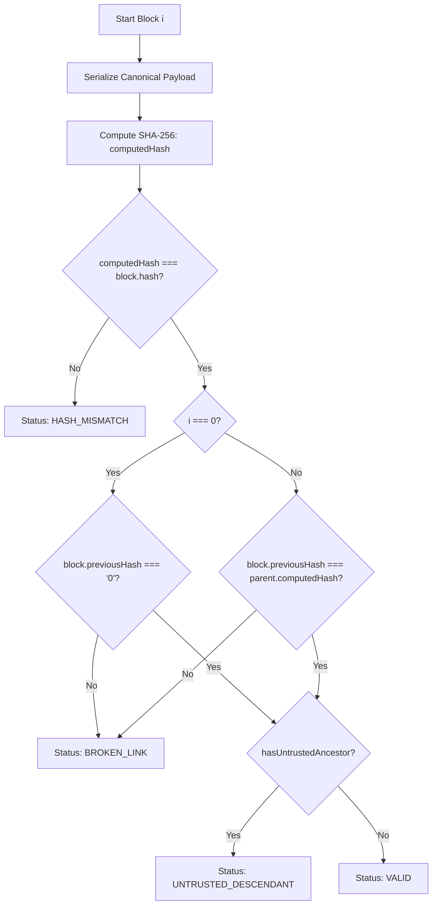

# ChainTrace — Blockchain Transaction Integrity Simulator

[](https://nodejs.org/)
[](https://react.dev/)
[](https://www.typescriptlang.org/)
[](https://vitejs.dev/)
[](https://tailwindcss.com/)
[](https://vitest.dev/)

An interactive educational web simulator built for **FinTech Engineering & Digital Financial Systems** coursework. It demonstrates how a blockchain-style sequential hash chain detects unauthorized modifications to historical financial records using real **SHA-256** cryptographic digests.

---

## 1. Project Purpose & Core Concept

In traditional databases, an attacker with unauthorized database privileges could modify an existing transaction record (for example, altering a payment from ₹2,500 to ₹9,250) without immediate detection unless specialized audit logs are configured.

In a **blockchain-style hash chain**:
1. Every block computes a cryptographic digest of its complete payload (index, timestamp, transaction list, previous block hash, and nonce).
2. Every subsequent block explicitly embeds the predecessor block's cryptographic hash in its `previousHash` field.
3. Modifying even a single character or paise in a past transaction fundamentally alters that block's recomputed hash (the cryptographic avalanche effect).
4. Because the attacker modified data without recalculating stored headers, the block's **recomputed hash diverges from its originally recorded hash**.
5. Furthermore, the downstream child block's `previousHash` pointer points to the parent's *old* hash, immediately **severing the chain link** and rendering all subsequent descendants **untrusted**.

> [!NOTE]
> **Educational Sandbox Notice:** All financial transactions, participant names, and reference IDs in this project are strictly fictional and intended for academic demonstration. The application operates 100% in-browser memory without external banking, wallet, network, or server dependencies.

---

## 2. Key Features

- **Real SHA-256 Cryptography:** Uses the native browser **Web Crypto API** (`crypto.subtle.digest('SHA-256', ...)`) with lowercase 64-character hexadecimal digests. No fake or hard-coded hashes.
- **Deterministic Seed Chain:** Pre-populates 5 connected blocks: Block #0 (Genesis anchor with sentinel `0`) and Blocks #1 through #4 containing 10 realistic fictional INR transactions.
- **Multi-Level Integrity Classification:**
  - `VALID`: Content hash and parent link are intact; ancestral lineage is verified.
  - `HASH MISMATCH`: Direct content tampering where recomputed SHA-256 differs from stored hash.
  - `BROKEN LINK`: Downstream block pointing to predecessor's old hash rather than recomputed hash.
  - `UNTRUSTED DESCENDANT`: Block whose local hash matches but whose cryptographic lineage is tainted by an upstream failure.
- **Intentional Tampering Simulation:** An interactive modal allowing modification of sender, recipient, amount (INR), or description in non-genesis blocks. Stored hashes are intentionally left untouched to replicate an unauthorized database edit.
- **Cascade Impact Breakdown:** Side-by-side comparison of original stored hash versus recomputed current hash, expected parent hash versus actual child `previousHash`, and ancestry status.
- **Deterministic Verification Engine:** Pure, read-only verifier that recalculates hashes across the live in-memory state without repairing or mining blocks.
- **One-Click Demo Reset:** Rebuilds the pristine chain from immutable seed definitions and re-establishes valid cryptographic links.

---

## 3. Technology Stack

- **Frontend Framework:** React 18 (TypeScript)
- **Bundler & Dev Server:** Vite 6
- **Styling:** Tailwind CSS 3.4
- **Iconography:** `lucide-react`
- **Typography:** Google Fonts (`Inter` for UI, `JetBrains Mono` for cryptographic hashes)
- **Hashing Engine:** Browser Web Crypto API (`crypto.subtle`)
- **Automated Testing:** Vitest 3.x

---

## 4. Prerequisites & Installation

### Prerequisites
- Node.js **v18+** or **v20+** (tested on Node.js v24.21.0)
- npm **v9+** or **v11+**

### Installation
Clone or navigate to the repository directory and install dependencies:

```bash
git clone <repository-url>
cd MDM_SEM5_Project
npm install
```

---

## 5. Running the Application

### Development Server
Start the local Vite development server:

```bash
npm run dev
```

Open your browser and navigate to:
```
http://localhost:5173
```

### Production Build & Preview
Validate type-safety and compile the optimized production bundle:

```bash
# Type-check with TypeScript and bundle with Vite
npm run build

# Preview the production build locally
npm run preview
```

### Running Automated Tests
Run the Vitest test suite covering canonical serialization, SHA-256 hashing, seed integrity, tampering mutations, and cascade classification:

```bash
npm run test
```

---

## 6. College Viva / Live Presentation Demo Script (2–3 Minutes)

Use this structured walkthrough for a presentation or examination:

1. **Step 1: Baseline Verification**
   - Open ChainTrace (`http://localhost:5173`).
   - Point to the header badge: `Educational Sandbox · Fictional Data`.
   - Point to the **Summary Metrics**: 5 blocks, 10 transactions, overall status `VALID`.
   - Explain that all 5 blocks display green `VALID` badges because each block's current content matches its stored SHA-256 hash and each block's `previousHash` matches its parent's stored hash.

2. **Step 2: Inspect Block #2**
   - Click on **Block #2** in the horizontal ledger.
   - Show the **Block Details Panel**: examine the full 64-character stored hash and parent link.
   - Point to the transaction table: locate transaction `tx-201` (Rohan Gupta paying TechHub Electronics ₹8,750.00).

3. **Step 3: Simulate Unauthorized Edit**
   - Click the red **Simulate Edit** button next to transaction `tx-201`.
   - Highlight the modal dialog warning:
     > *"This simulates an unauthorized database update. The transaction data will change, but original stored hashes and subsequent previous-hash references will intentionally NOT be recalculated."*
   - Change the amount from `₹8,750.00` to `₹99,999.00`.
   - Click **Apply Simulated Edit**.

4. **Step 4: Demonstrate the Cryptographic Cascade**
   - Point out that the overall chain status immediately flips to **`INTEGRITY FAILURE`**.
   - Show how the three blocks illustrate three distinct failure stages:
     - **Block #2 (`HASH MISMATCH`):** The edited transaction caused its recomputed SHA-256 digest to diverge from its original stored hash.
     - **Block #3 (`BROKEN LINK`):** Block #3's `previousHash` still references Block #2's old hash, breaking the parent link.
     - **Block #4 (`UNTRUSTED DESCENDANT`):** Block #4's local hash matches, but its cryptographic ancestry is invalid.
   - Review the **Cascade Impact Breakdown** section showing the full stored vs. recomputed hash strings.

5. **Step 5: Verify Non-Auto-Repair Behavior**
   - Click **Verify Chain**. Show that re-verifying recalculates the report deterministically without repairing the chain.

6. **Step 6: Reset Demo**
   - Click **Reset Demo**.
   - Show that the chain is rebuilt cleanly from original immutable seed definitions, returning the chain to `VALID` with Block #2 restored to ₹8,750.00.

---

## 7. How the Verification Algorithm Works

For every block in ascending index order:



### Precedence Hierarchy:
1. `HASH_MISMATCH`: Takes precedence if local content has diverged from stored hash.
2. `BROKEN_LINK`: Triggered if child's `previousHash` does not match parent's recomputed hash.
3. `UNTRUSTED_DESCENDANT`: Assigned if block is locally valid but an ancestor failed.
4. `VALID`: Assigned only when local hash matches, parent link matches, and all ancestors are trusted.

---

## 8. Educational Limitations vs. Production Blockchains

While this simulator demonstrates the **tamper-evident** property of sequential hash chains, it is crucial to understand the distinction between this educational model and production decentralized blockchains:

| Characteristic | ChainTrace Educational Simulator | Production Blockchains (e.g., Bitcoin, Ethereum, Hyperledger) |
|---|---|---|
| **Storage Architecture** | In-memory client-side single array | Globally replicated peer-to-peer (P2P) distributed ledger |
| **Tamper Resistance** | **Tamper-evident only**: A local adversary with full database access could recalculate all subsequent hashes. | **Tamper-resistant**: An attacker cannot unilaterally alter history without overcoming network consensus. |
| **Consensus Mechanism** | None (sequential in-memory build) | Proof-of-Work (PoW), Proof-of-Stake (PoS), Raft, or PBFT |
| **Transaction Authorization** | Form inputs without cryptographic keys | Asymmetric digital signatures (ECDSA/Ed25519) with public/private key pairs |
| **Execution Environment** | Client browser runtime (no server) | Decentralized state machines / Virtual Machines (EVM, WASM) |

---

## 9. Automated Testing Verification

The project includes unit tests executed with Vitest:

```text
 ✓ src/test/blockchain.test.ts (12 tests)
   ✓ Blockchain Core Cryptography & Serialization > excludes stored block hash from canonical payload object
   ✓ Blockchain Core Cryptography & Serialization > generates a 64-character lowercase hexadecimal SHA-256 digest
   ✓ Blockchain Core Cryptography & Serialization > produces identical SHA-256 digests for identical payloads (determinism)
   ✓ Blockchain Core Cryptography & Serialization > produces different hash when transaction amount changes
   ✓ Chain Construction & Seed Integrity > seeds at least five blocks and at least eight transactions
   ✓ Chain Construction & Seed Integrity > builds a pristine sequential chain with proper previousHash links
   ✓ Chain Construction & Seed Integrity > verifies a pristine chain as 100% VALID
   ✓ Intentional Tampering & Tamper Evidence Verification > immutably alters a transaction while strictly preserving stored block hashes
   ✓ Intentional Tampering & Tamper Evidence Verification > accurately classifies HASH_MISMATCH, BROKEN_LINK, and UNTRUSTED_DESCENDANT
   ✓ Intentional Tampering & Tamper Evidence Verification > rejects editing genesis block
   ✓ Intentional Tampering & Tamper Evidence Verification > resets cleanly by rebuilding a brand new valid chain
   ✓ Transaction Form Validation > validates required sender, recipient, positive finite amount, and description
```

---

## 10. Repository Structure

```text
.
├── IMPLEMENTATION_PLAN.md              # Project specification & algorithmic source of truth
├── ANTIGRAVITY_SUPER_PROMPT.md         # Super prompt specifications
├── README.md                           # Documentation, setup & demo guide
├── package.json                        # Dependencies & npm scripts
├── vite.config.ts                      # Vite configuration
├── tsconfig.json                       # TypeScript compiler options
├── tailwind.config.js                  # Tailwind design system configuration
├── postcss.config.js                   # PostCSS configuration
├── index.html                          # HTML entry point with Google Fonts
└── src/
    ├── main.tsx                        # Application mount entry point
    ├── App.tsx                         # Core state orchestration & responsive layout
    ├── index.css                       # Global styles & custom scrollbars
    ├── types/
    │   └── blockchain.ts               # Strict TypeScript models
    ├── data/
    │   └── seedData.ts                 # Fictional seed ledger (5 blocks, 10 transactions)
    ├── lib/
    │   ├── formatters.ts               # INR currency, date & hash formatters
    │   └── blockchain/
    │       ├── serialize.ts            # Canonical payload serialization
    │       ├── hash.ts                 # Web Crypto API SHA-256 digest
    │       ├── buildChain.ts           # Pristine sequential chain builder
    │       ├── tamper.ts               # Immutable transaction tampering helper
    │       └── verifyChain.ts          # Pure read-only cryptographic verifier
    ├── components/
    │   ├── AppHeader.tsx               # Header with actions & sandbox badge
    │   ├── SummaryMetricCard.tsx       # Live derived metric summary cards
    │   ├── BlockchainView.tsx          # Connected horizontal/responsive block timeline
    │   ├── BlockCard.tsx               # Individual block card with hashes & links
    │   ├── BlockDetailsPanel.tsx       # Selected block inspection & hash comparison
    │   ├── TransactionTable.tsx        # Fictional transaction ledger with edit triggers
    │   ├── TamperTransactionDialog.tsx # Modal editor with real-time validation & warnings
    │   ├── IntegritySummary.tsx        # Cascade breach breakdown & side-by-side comparison
    │   ├── IntegrityBadge.tsx          # Status badges with accessible icons & colors
    │   └── HowItWorks.tsx              # 5-step detection explainer & limitation notes
    └── test/
        └── blockchain.test.ts          # Vitest test suite
```

---

## 11. Academic Integrity & License

This project was developed for educational purposes under the FinTech Engineering syllabus. Code is structured cleanly for inspection, evaluation, and learning.
